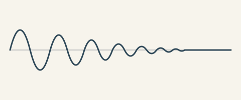

<!-- comdtex-welcome: 2 -->

# Computational biology example

> The two frontmatter lines above switch on the biology conventions for this
> note only: accession links, gene and species checks, and the Data
> availability reminder. The rest of this page (pipeline values, sequences,
> supplementary numbering) works in any note. Back to [[comdtex]].

## Numbers from your pipeline

Your analysis writes its results to a file in the vault. Declare the file once
and quote values from it, so the text always matches the last run:

:::data{#data:stats}
comdtex-examples/stats.csv
:::

:::data{#data:model}
comdtex-examples/model.json
:::

Loss of *Trp53* raised tumor incidence (val(stats, pvalue, p)) in
n = val(stats, n) *Mus musculus* animals, with a mean effect of
si(val(stats, effect, 3sf), mg/L) (95% CI val(stats, effect, ci_low, .2f) to
val(stats, effect, ci_high, .2f)). The classifier reached an AUC of
val(model, metrics.auc, .3f) and a first-fold accuracy of val(model, folds.0.acc).

Change a number in `stats.csv`, come back to this window, and the text above
updates. A value that is missing shows a visible note instead of disappearing.

## Organisms, genes and species

With `comdtex.organism: mouse`, gene symbols follow mouse conventions (*Trp53*,
italic) while proteins stay upright (p53). The first mention of a species uses
the full name, *Escherichia coli*, and later ones may abbreviate it: *E. coli*.
Try writing `*TRP53*` or `E. coli` before the full name to see the warnings,
and press Ctrl+. on a warning for the quick fix.

## Accession numbers

Identifiers link to their database in the preview and in the LaTeX export:
the reference genome NC_000017.11, the transcript NM_000546.6, the run
SRR1234567, the series GSE12345, the gene ENSMUSG00000059552 and the structure
PDB 1TUP. Your file is never changed; the links exist only in the output.

## Sequences

:::seq[Cloning site]
type: dna
highlight: 1-6 EcoRI, 13-18 BamHI
motif: GAATTC
revcomp: yes
>insert demo fragment
GAATTCATGGCCGGATCCAAGCTTGGATCCGCGGCCGCATGCTAGC
:::

## Results

Growth of both strains is shown in @fig:growth-main and summarized in
@tbl:summary.

{#fig:growth-main}

| Strain | Doubling time (h) |
|---|---|
| Wild type | 1.9 |
| Mutant | 2.6 |
{#tbl:summary}

## Data availability

Raw reads are available under SRR1234567 and processed data under GSE12345.

<!-- supplement -->

## Supplementary material

Everything after the `supplement` marker restarts figure and table numbers
with an S: @fig:growth-replicate and @tbl:primers.

{#fig:growth-replicate}

| Primer | Sequence |
|---|---|
| Forward | GAATTCATGGCC |
| Reverse | GCTAGCATGCGG |
{#tbl:primers}

## More for biology papers

- **PubMed citations**: paste a PMID or PMCID into the **Citation manager**.
- **Journal templates**: PLOS, Bioinformatics, BMC and bioRxiv under
  **File > New from template**.
- **Quarto and R Markdown**: `.qmd` and `.Rmd` files open and save untouched,
  and **Import document (Pandoc)** brings in Jupyter notebooks.
