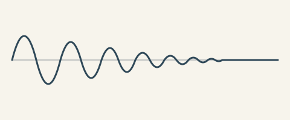

<!-- comdtex-welcome: 2 -->

# Ejemplo de biología computacional

> Las dos líneas del frontmatter de arriba activan las convenciones de biología
> solo para esta nota: enlaces de accesión, revisión de genes y especies, y el
> recordatorio de disponibilidad de datos. El resto de la página (valores del
> pipeline, secuencias, numeración suplementaria) funciona en cualquier nota.
> Volver a [[comdtex]].

## Números desde tu pipeline

Tu análisis escribe sus resultados en un archivo del vault. Declara el archivo
una vez y cita valores de él, así el texto siempre coincide con la última
ejecución:

:::data{#data:stats}
comdtex-examples/stats.csv
:::

:::data{#data:model}
comdtex-examples/model.json
:::

La pérdida de *Trp53* aumentó la incidencia de tumores (val(stats, pvalue, p))
en n = val(stats, n) animales de *Mus musculus*, con un efecto medio de
si(val(stats, effect, 3sf), mg/L) (IC del 95 %: val(stats, effect, ci_low, .2f)
a val(stats, effect, ci_high, .2f)). El clasificador alcanzó un AUC de
val(model, metrics.auc, .3f) y una exactitud de val(model, folds.0.acc) en el
primer pliegue.

Cambia un número en `stats.csv`, vuelve a esta ventana y el texto de arriba se
actualiza. Un valor que falta muestra una nota visible en vez de desaparecer.

## Organismos, genes y especies

Con `comdtex.organism: mouse`, los símbolos de genes siguen las convenciones
del ratón (*Trp53*, en cursiva) y las proteínas quedan en redonda (p53). La
primera mención de una especie usa el nombre completo, *Escherichia coli*, y
las siguientes pueden abreviarlo: *E. coli*. Prueba a escribir `*TRP53*` o
`E. coli` antes del nombre completo para ver las advertencias, y pulsa Ctrl+.
sobre una advertencia para el arreglo rápido.

## Números de accesión

Los identificadores enlazan a su base de datos en la vista previa y en la
exportación a LaTeX: el genoma de referencia NC_000017.11, el tránscrito
NM_000546.6, la corrida SRR1234567, la serie GSE12345, el gen
ENSMUSG00000059552 y la estructura PDB 1TUP. Tu archivo nunca cambia: los
enlaces solo existen en la salida.

## Secuencias

:::seq[Sitio de clonación]
type: dna
highlight: 1-6 EcoRI, 13-18 BamHI
motif: GAATTC
revcomp: yes
>insert fragmento de ejemplo
GAATTCATGGCCGGATCCAAGCTTGGATCCGCGGCCGCATGCTAGC
:::

## Resultados

El crecimiento de ambas cepas aparece en @fig:crecimiento-principal y se
resume en @tbl:resumen.

{#fig:crecimiento-principal}

| Cepa | Tiempo de duplicación (h) |
|---|---|
| Silvestre | 1.9 |
| Mutante | 2.6 |
{#tbl:resumen}

## Disponibilidad de datos

Las lecturas crudas están en SRR1234567 y los datos procesados en GSE12345.

<!-- supplement -->

## Material suplementario

Todo lo que va después del marcador `supplement` reinicia la numeración de
figuras y tablas con una S: @fig:crecimiento-replica y @tbl:cebadores.

{#fig:crecimiento-replica}

| Cebador | Secuencia |
|---|---|
| Directo | GAATTCATGGCC |
| Reverso | GCTAGCATGCGG |
{#tbl:cebadores}

## Más para artículos de biología

- **Citas de PubMed**: pega un PMID o un PMCID en el **Gestor de citas**.
- **Plantillas de revistas**: PLOS, Bioinformatics, BMC y bioRxiv en
  **Archivo > Nuevo desde plantilla**.
- **Quarto y R Markdown**: los archivos `.qmd` y `.Rmd` se abren y se guardan
  sin tocarlos, e **Importar documento (Pandoc)** trae notebooks de Jupyter.
