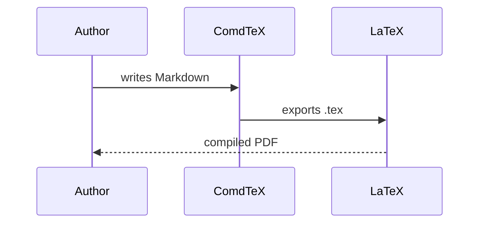

<!-- comdtex-welcome: 2 -->
# Welcome to ComdTeX

> This file is yours: edit it, delete it, or keep it as a cheat sheet. Every
> block below is live, so the preview on the right shows what each one does.
> If you delete it, ComdTeX does not bring it back. **Restore example files**
> in the command palette (Ctrl+Shift+P) writes a fresh copy whenever you want.

[[toc]]

## Writing and formatting {#sec:writing}

Plain Markdown works as you expect: **bold**, *italic*, `inline code`,
==highlight==, <u>underline</u>, ~~strikethrough~~ and [links](https://comdtex.witara.site/docs).

- [ ] Task lists are tracked by the **Tasks** panel across the whole vault
- [x] Ticking a box in the preview edits the file

Footnotes collect at the end of the document.[^footnote]

[^footnote]: Like this one. Click the number to jump back.

## Shorthands: type and press Tab {#sec:shorthands}

Shorthands are short functions that expand to LaTeX. Outside math they wrap
themselves in `$...$`, so the common ones need no delimiters at all:

The fraction frac(1, n+1) gets small as n grows, sqrt(2) is irrational and
the limit lim(x, 0) is written exactly like that.

The sum sum(n=1, 100), the integral int(0, 1), the partial derivative
pder(u, t), the total derivative der(f, x) and the inverse inv(A).

Blackboard and calligraphic letters: bb(R), bb(N), cal(L). A matrix:

mat(1,0,0, 0,1,0, 0,0,1)

Shorthands nest and also work inside a formula you write yourself:
$frac(1, sqrt(2 \pi)) sup(e, -sup(x, 2)/2)$ is the Gaussian density.

Units and chemistry typeset the way journals expect, and export to `siunitx`
and `mhchem`: si(9.81, m/s^2), si(1.5(2), mol/L), num(6.022e23), unit(kg*m/s^2)
and ce(H2SO4).

## Math environments {#sec:environments}

Open an environment with `:::type[Title]` and close it with `:::`. A label in
braces after the title makes it citable with `@`.

:::definition[Continuous function]{#def:continuous}
A function $f$ is **continuous** at $x_0$ when the limit exists and equals the
value of the function:

$$lim(x, x_0) f(x) = f(x_0)$$ {#eq:continuity}
:::

:::theorem[Sum of continuous functions]{#thm:sum}
If $f$ and $g$ are continuous at $x_0$, so is $f + g$.
:::

:::proof
Apply @eq:continuity to each function and add the limits.
:::

:::remark
@thm:sum follows from @def:continuous. `proof`, `remark` and `note` are not
numbered; `theorem`, `lemma`, `corollary`, `proposition`, `definition`,
`example` and `exercise` are, each with its own counter.
:::

:::sm note
Put `sm` or `lg` before the type to make a block smaller or larger.
:::

## Equations and cross-references {#sec:equations}

`$$...$$` blocks are numbered automatically, and `{#eq:name}` lets you cite them:

$$sum(n=0, \infty) sup(x, n) = frac(1, 1-x)$$ {#eq:geometric}

$$sup(e, i\pi) + 1 = 0$$ {#eq:euler}

The geometric series @eq:geometric and Euler's identity @eq:euler are two of
the most elegant formulas in mathematics. Inline math can carry a label too:
$lim(x, 0) frac(sin(x), x) = 1$ {#eq:fundamental}, cited as @eq:fundamental.

Headings, figures and tables take labels the same way: this section is
@sec:equations. Ctrl+click or F12 on any reference jumps to its target.

## Figures and tables {#sec:figures}

{#fig:wave}

@fig:wave is an image with a caption and a label. Tables are labeled on the
line right after them, as @tbl:symbols shows:

| Symbol | Meaning |
|---|---|
| $\varepsilon$ | An arbitrarily small positive number |
| $\nabla$ | Gradient |
{#tbl:symbols}

`table(Concept, Definition, Example)` on its own line, followed by Tab, writes
the header of a new table for you.

## Tables and plots from data {#sec:data}

A `:::csv` block keeps a table wired to its file: change the CSV and the table
follows. A `:::data` block names a selection once so other blocks can reuse it.

:::data{#data:growth}
comdtex-examples/growth.csv
:::

:::csv[Bacterial growth]{#tbl:growth}
@data:growth (hour, wild_type, mutant)
:::

:::plot[Growth curves]
@data:growth
x: hour
y: (wild_type, mutant)
kind: line
error: sd
:::

A plot can also draw functions, with no data at all:

:::plot[Damped oscillation]
f(x) = exp(-x / 4) * cos(2 * x)
g(x) = exp(-x / 4)
range: [0, 12]
:::

`val()` quotes a single number from a results file, so the text never drifts
from the analysis: the mutant reached an OD of val(growth, "8", mutant, .2f)
after eight hours. Biology papers use this a lot; see [[comdtex-biology]].

## Diagrams {#sec:diagrams}

:::graph[Shortest path]
A -- B : 4
A -- C : 2
B -- C : 1
B -- D : 5
C -- D : 8
D -- E : 3
:::

`--` is undirected, `->` directed, and `: weight` adds a label.

:::commdiag[Pullback]
A -> B [f]
A -> C [g]
B -> D [h]
C -> D [k]
:::

Arrow styles: `->`, `<-`, `<->`, `->>` (epi), `>->` (mono), `==>` (double).

:::truth[Contrapositive]
(p -> q) <-> (!q -> !p)
:::

Truth tables accept `¬ ∧ ∨ → ↔`, `! && || -> <->` or the words `not and or
implies iff`.

Pseudocode becomes a numbered algorithm with a folding flowchart, and
`:::flowchart` draws the flowchart directly:

:::pseudocode[Binary search]
ALGORITHM BinarySearch(A, target)
    INPUT sorted array A, value target
    lo ← 0
    hi ← length(A) - 1
    WHILE lo ≤ hi
        mid ← (lo + hi) / 2
        IF A[mid] = target
            RETURN mid
        ELSE IF A[mid] < target
            lo ← mid + 1
        ELSE
            hi ← mid - 1
        ENDIF
    ENDWHILE
    RETURN -1
END
:::

:::flowchart[Euclid's algorithm]
ALGORITHM Gcd(a, b)
    WHILE b ≠ 0
        t ← b
        b ← a mod b
        a ← t
    ENDWHILE
    RETURN a
END
:::

A fenced block in the `mermaid` language renders any Mermaid diagram:



For freehand drawings, **Insert Excalidraw drawing** in the palette adds an `:::excalidraw`
block that opens a full drawing editor, stored inside the note.

## Code {#sec:code}

```python
def fib(n):
    a, b = 0, 1
    for _ in range(n):
        a, b = b, a + b
    return a
```

:::code haskell
factorial :: Integer -> Integer
factorial 0 = 1
factorial n = n * factorial (n - 1)
:::

## Callouts {#sec:callouts}

> [!note]
> Callouts are highlighted blocks with an icon, compatible with Obsidian.

> [!tip] Shortcuts
> Ctrl+P opens files (and finds commands, headings, labels and settings),
> Ctrl+Shift+P runs commands, Ctrl+Shift+F searches the vault, Ctrl+Alt+P
> toggles the preview and Ctrl+. applies a quick fix.

> [!warning]
> Other types: `important`, `danger`, `success`, `question`, `quote`, `info`,
> `example` and more.

## Links, embeds and citations {#sec:links}

`[[note-name]]` links to another note in the vault, like this link to the
biology example: [[comdtex-biology]]. The **Backlinks** panel lists the notes
that link to the active one. `![[note-name]]` embeds a whole note in place,
which is how a thesis keeps one main file and a file per chapter.

Citations come from `references.bib` in the vault root:

```markdown
As shown by [@knuth1984], and later by [@lamport1994; @watson1953].
```

The **Citation manager** adds entries by DOI, arXiv id, PMID or PMCID, and
`[@` completes keys by author, title or year.

## Next steps {#sec:next}

- Define your own LaTeX commands in `macros.md` (**Vault > Edit macros.md**)
- Start a paper, thesis or exam from **File > New from template**, including
  PLOS, Bioinformatics, BMC and bioRxiv layouts
- Compile to PDF from the palette (**Compile PDF (WASM engine)**): a LaTeX engine is built
  in, nothing to install
- Export to LaTeX, Word, Typst, Beamer, Reveal.js or Obsidian from the **File** menu
- Open the biology example, [[comdtex-biology]], for pipeline values,
  sequences, accession links and supplementary numbering
- Read the full guide at https://comdtex.witara.site/docs
