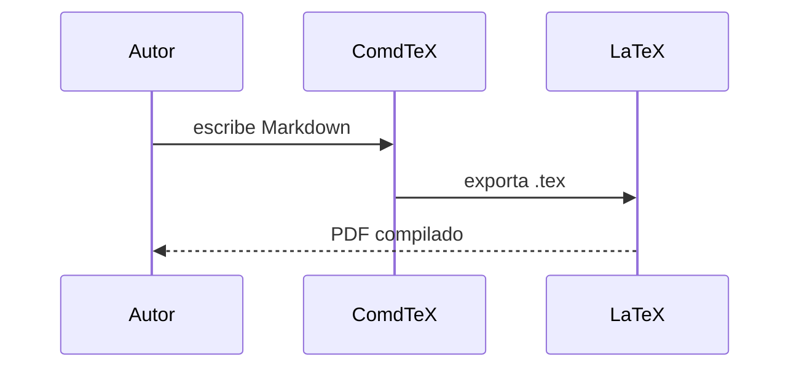

<!-- comdtex-welcome: 2 -->
# Bienvenido a ComdTeX

> Este archivo es tuyo: edítalo, bórralo o guárdalo como chuleta. Cada bloque
> de abajo está vivo, así que la vista previa de la derecha muestra lo que hace.
> Si lo borras, ComdTeX no lo vuelve a crear. **Restaurar archivos de ejemplo**
> en la paleta de comandos (Ctrl+Shift+P) escribe una copia nueva cuando quieras.

[[toc]]

## Escribir y dar formato {#sec:escribir}

El Markdown de siempre funciona como esperas: **negrita**, *cursiva*,
`código en línea`, ==resaltado==, <u>subrayado</u>, ~~tachado~~ y
[enlaces](https://comdtex.witara.site/docs).

- [ ] El panel **Tareas** reúne las listas de tareas de todo el vault
- [x] Marcar una casilla en la vista previa edita el archivo

Las notas al pie se juntan al final del documento.[^nota]

[^nota]: Como esta. Haz clic en el número para volver.

## Shorthands: escribe y pulsa Tab {#sec:shorthands}

Los shorthands son funciones cortas que se expanden a LaTeX. Fuera de las
fórmulas se envuelven solos en `$...$`, así que los comunes no necesitan
delimitadores:

La fracción frac(1, n+1) se hace pequeña cuando n crece, sqrt(2) es irracional
y el límite lim(x, 0) se escribe exactamente así.

La suma sum(n=1, 100), la integral int(0, 1), la derivada parcial pder(u, t),
la derivada total der(f, x) y la inversa inv(A).

Letras de pizarra y caligráficas: bb(R), bb(N), cal(L). Una matriz:

mat(1,0,0, 0,1,0, 0,0,1)

Los shorthands se anidan y también funcionan dentro de una fórmula escrita por
ti: $frac(1, sqrt(2 \pi)) sup(e, -sup(x, 2)/2)$ es la densidad gaussiana.

Las unidades y la química salen como las piden las revistas, y se exportan a
`siunitx` y `mhchem`: si(9.81, m/s^2), si(1.5(2), mol/L), num(6.022e23),
unit(kg*m/s^2) y ce(H2SO4).

## Entornos matemáticos {#sec:entornos}

Abre un entorno con `:::tipo[Título]` y ciérralo con `:::`. Una etiqueta entre
llaves después del título permite citarlo con `@`.

:::definition[Función continua]{#def:continua}
Una función $f$ es **continua** en $x_0$ cuando el límite existe y coincide
con el valor de la función:

$$lim(x, x_0) f(x) = f(x_0)$$ {#eq:continuidad}
:::

:::theorem[Suma de funciones continuas]{#thm:suma}
Si $f$ y $g$ son continuas en $x_0$, también lo es $f + g$.
:::

:::proof
Aplica @eq:continuidad a cada función y suma los límites.
:::

:::remark
@thm:suma se sigue de @def:continua. `proof`, `remark` y `note` no llevan
número; `theorem`, `lemma`, `corollary`, `proposition`, `definition`,
`example` y `exercise` sí, cada uno con su propio contador.
:::

:::sm note
Pon `sm` o `lg` antes del tipo para hacer un bloque más pequeño o más grande.
:::

## Ecuaciones y referencias cruzadas {#sec:ecuaciones}

Los bloques `$$...$$` se numeran solos, y `{#eq:nombre}` permite citarlos:

$$sum(n=0, \infty) sup(x, n) = frac(1, 1-x)$$ {#eq:geometrica}

$$sup(e, i\pi) + 1 = 0$$ {#eq:euler}

La serie geométrica @eq:geometrica y la identidad de Euler @eq:euler son dos
de las fórmulas más elegantes de las matemáticas. Las fórmulas en línea
también pueden llevar etiqueta: $lim(x, 0) frac(sin(x), x) = 1$
{#eq:fundamental}, citada como @eq:fundamental.

Los títulos, las figuras y las tablas se etiquetan igual: esta sección es
@sec:ecuaciones. Ctrl+clic o F12 sobre cualquier referencia salta a su destino.

## Figuras y tablas {#sec:figuras}

{#fig:onda}

@fig:onda es una imagen con pie y etiqueta. Las tablas se etiquetan en la
línea justo después, como en @tbl:simbolos.

| Símbolo | Significado |
|---|---|
| $\varepsilon$ | Un número positivo arbitrariamente pequeño |
| $\nabla$ | Gradiente |
{#tbl:simbolos}

`table(Concepto, Definición, Ejemplo)` en su propia línea, seguido de Tab,
escribe por ti el encabezado de una tabla nueva.

## Tablas y gráficas desde datos {#sec:datos}

Un bloque `:::csv` mantiene una tabla conectada a su archivo: si cambias el
CSV, la tabla cambia con él. Un bloque `:::data` le pone nombre a una selección
una sola vez para que otros bloques la reutilicen.

:::data{#data:growth}
comdtex-examples/growth.csv
:::

:::csv[Crecimiento bacteriano]{#tbl:crecimiento}
@data:growth (hour, wild_type, mutant)
:::

:::plot[Curvas de crecimiento]
@data:growth
x: hour
y: (wild_type, mutant)
kind: line
error: sd
:::

Una gráfica también puede dibujar funciones, sin datos:

:::plot[Oscilación amortiguada]
f(x) = exp(-x / 4) * cos(2 * x)
g(x) = exp(-x / 4)
range: [0, 12]
:::

`val()` cita un solo número de un archivo de resultados, así el texto nunca se
aleja del análisis: el mutante llegó a una DO de val(growth, "8", mutant, .2f)
a las ocho horas. Los artículos de biología lo usan mucho; mira
[[comdtex-biology]].

## Diagramas {#sec:diagramas}

:::graph[Camino mínimo]
A -- B : 4
A -- C : 2
B -- C : 1
B -- D : 5
C -- D : 8
D -- E : 3
:::

`--` es no dirigido, `->` dirigido, y `: peso` añade una etiqueta.

:::commdiag[Pullback]
A -> B [f]
A -> C [g]
B -> D [h]
C -> D [k]
:::

Estilos de flecha: `->`, `<-`, `<->`, `->>` (epi), `>->` (mono), `==>` (doble).

:::truth[Contrapositiva]
(p -> q) <-> (!q -> !p)
:::

Las tablas de verdad aceptan `¬ ∧ ∨ → ↔`, `! && || -> <->` o las palabras
`not and or implies iff`.

El pseudocódigo se convierte en un algoritmo numerado con un diagrama de flujo
plegable, y `:::flowchart` dibuja el diagrama directamente:

:::pseudocode[Búsqueda binaria]
ALGORITHM BinarySearch(A, target)
    INPUT arreglo ordenado A, valor target
    lo ← 0
    hi ← length(A) - 1
    WHILE lo ≤ hi
        mid ← (lo + hi) / 2
        IF A[mid] = target
            RETURN mid
        ELSE IF A[mid] < target
            lo ← mid + 1
        ELSE
            hi ← mid - 1
        ENDIF
    ENDWHILE
    RETURN -1
END
:::

:::flowchart[Algoritmo de Euclides]
ALGORITHM Mcd(a, b)
    WHILE b ≠ 0
        t ← b
        b ← a mod b
        a ← t
    ENDWHILE
    RETURN a
END
:::

Un bloque de código en el lenguaje `mermaid` dibuja cualquier diagrama Mermaid:



Para dibujos a mano alzada, **Insertar dibujo Excalidraw** en la paleta añade un bloque
`:::excalidraw` que abre un editor de dibujo completo, guardado dentro de la nota.

## Código {#sec:codigo}

```python
def fib(n):
    a, b = 0, 1
    for _ in range(n):
        a, b = b, a + b
    return a
```

:::code haskell
factorial :: Integer -> Integer
factorial 0 = 1
factorial n = n * factorial (n - 1)
:::

## Callouts {#sec:callouts}

> [!note]
> Los callouts son bloques destacados con icono, compatibles con Obsidian.

> [!tip] Atajos
> Ctrl+P abre archivos (y encuentra comandos, títulos, etiquetas y ajustes),
> Ctrl+Shift+P ejecuta comandos, Ctrl+Shift+F busca en el vault, Ctrl+Alt+P
> muestra u oculta la vista previa y Ctrl+. aplica un arreglo rápido.

> [!warning]
> Otros tipos: `important`, `danger`, `success`, `question`, `quote`, `info`,
> `example` y más.

## Enlaces, inclusiones y citas {#sec:enlaces}

`[[nombre-de-nota]]` enlaza otra nota del vault, como este enlace al ejemplo
de biología: [[comdtex-biology]]. El panel **Backlinks** lista las notas que
enlazan a la activa. `![[nombre-de-nota]]` incluye una nota entera en su
lugar: así una tesis tiene un archivo principal y uno por capítulo.

Las citas salen de `references.bib`, en la raíz del vault:

```markdown
Como mostró [@knuth1984], y después [@lamport1994; @watson1953].
```

El **Gestor de citas** añade entradas por DOI, id de arXiv, PMID o PMCID, y
`[@` completa claves por autor, título o año.

## Siguientes pasos {#sec:siguientes}

- Define tus propios comandos LaTeX en `macros.md` (**Vault > Editar macros.md**)
- Empieza un artículo, una tesis o un examen desde **Archivo > Nuevo desde
  plantilla**, incluidos los formatos de PLOS, Bioinformatics, BMC y bioRxiv
- Compila a PDF desde la paleta (**Compilar PDF (motor WASM)**): el motor LaTeX viene
  incluido, no hay nada que instalar
- Exporta a LaTeX, Word, Typst, Beamer, Reveal.js u Obsidian desde el menú
  **Archivo**
- Abre el ejemplo de biología, [[comdtex-biology]], para valores del
  pipeline, secuencias, enlaces de accesión y numeración suplementaria
- Lee la guía completa en https://comdtex.witara.site/docs
